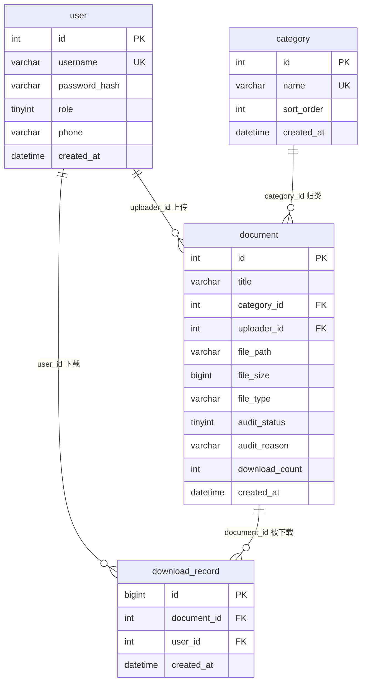

# 项目 A 数据库设计（校园课程资料 / 历年试题共享平台）

> 库名：`campus_doc`　字符集：`utf8mb4`　引擎：`InnoDB`
> 定位：学生按课程上传、检索、下载历年试题和复习资料；管理员审核内容。

---

## 一、关系总览



一句话读法：**`category` 一对多 `document`；`user` 既一对多 `document`（上传）也一对多 `download_record`（下载）；`document` 一对多 `download_record`。**

---

## 二、表结构

### 1. `user` 用户表

| 字段 | 类型 | 约束 | 说明 |
|---|---|---|---|
| `id` | INT UNSIGNED | PK, AUTO_INCREMENT | 主键 |
| `username` | VARCHAR(32) | NOT NULL, **UNIQUE** | 登录账号 |
| `password_hash` | VARCHAR(60) | NOT NULL | **BCrypt 加密结果，绝不存明文**（BCrypt 固定 60 字符） |
| `role` | TINYINT | NOT NULL DEFAULT 1 | 1=学生，2=管理员 |
| `phone` | VARCHAR(20) | NULL | 可选 |
| `created_at` | DATETIME | NOT NULL DEFAULT CURRENT_TIMESTAMP | 注册时间 |

**设计说明**
- `role` 用一个字段区分角色，**不单独建管理员表**——管理员只是"角色不同的人"，不是另一种实体
- 不存 `age`。年龄逐年变化，存下来第二年就是错的；真需要就存 `birthday` 用的时候算。**原则：能推算出来的数据不要存**
- 密码字段叫 `password_hash` 而不是 `password`，从命名上杜绝"存明文"的可能

### 2. `category` 分类表

| 字段 | 类型 | 约束 | 说明 |
|---|---|---|---|
| `id` | INT UNSIGNED | PK, AUTO_INCREMENT | |
| `name` | VARCHAR(64) | NOT NULL, **UNIQUE** | 课程名，如"高等数学" |
| `sort_order` | INT | NOT NULL DEFAULT 0 | 展示排序 |
| `created_at` | DATETIME | NOT NULL DEFAULT CURRENT_TIMESTAMP | |

**为什么单独建表，而不是在 document 里存 `category_name` 字符串？**
1. **重复**：几百份资料都写一遍"高等数学"
2. **改不动**：想把"高等数学"改成"高数"，得改几百行
3. **没法扩展**：想给分类加"所属学院""任课老师"，没有地方放

> 通用原则：**一个东西会被多处引用，就该单独建表。**

### 3. `document` 资料表

| 字段 | 类型 | 约束 | 说明 |
|---|---|---|---|
| `id` | INT UNSIGNED | PK, AUTO_INCREMENT | |
| `title` | VARCHAR(128) | NOT NULL | 资料标题 |
| `category_id` | INT UNSIGNED | NOT NULL, **逻辑外键** | 指向 `category.id` |
| `uploader_id` | INT UNSIGNED | NOT NULL, **逻辑外键** | 指向 `user.id` |
| `file_path` | VARCHAR(255) | NOT NULL | 服务器上的存储路径（**数据库不存文件本体**） |
| `file_size` | BIGINT UNSIGNED | NOT NULL DEFAULT 0 | **字节数**，显示时换算 MB |
| `file_type` | VARCHAR(16) | NOT NULL | pdf / zip / docx |
| `audit_status` | TINYINT | NOT NULL DEFAULT 0 | 0=待审核、1=通过、2=驳回 |
| `audit_reason` | VARCHAR(255) | NULL | 驳回理由 |
| `download_count` | INT UNSIGNED | NOT NULL DEFAULT 0 | **冗余计数**（与 `download_record` 同事务更新） |
| `created_at` | DATETIME | NOT NULL DEFAULT CURRENT_TIMESTAMP | 上传时间 |

**设计说明**
- `file_size` 用 `BIGINT` 存**字节**，不用 `double` 存 "2.3MB"——浮点数有精度问题（`0.1+0.2 ≠ 0.3`），金额和容量都该用整数或 `DECIMAL`
- 审核信息（状态 + 理由）直接放本表，MVP 够用；等要做"多级审核/审核历史"再拆 `audit_record` 表
- `download_record.id` 用 `BIGINT`，因为"每次下载一行"，是增长最快的表

### 4. `download_record` 下载记录表

| 字段 | 类型 | 约束 | 说明 |
|---|---|---|---|
| `id` | **BIGINT** UNSIGNED | PK, AUTO_INCREMENT | 增长最快，用 BIGINT 防溢出 |
| `document_id` | INT UNSIGNED | NOT NULL, **逻辑外键** | |
| `user_id` | INT UNSIGNED | NOT NULL, **逻辑外键** | |
| `created_at` | DATETIME | NOT NULL DEFAULT CURRENT_TIMESTAMP | 下载时间 |

**存在意义**：可审计（谁下载了什么）、可分析（热门资料排行）、可作为冗余计数的**校正依据**。

---

## 三、索引设计

| 索引名 | 类型 | 字段顺序 | 服务的查询 |
|---|---|---|---|
| `PRIMARY` | 聚簇索引 | `id` | 主键查询 |
| `uk_username` | 唯一索引 | `username` | 登录时按账号查，且保证不重复 |
| `uk_name` | 唯一索引 | `category.name` | 防止重复课程分类 |
| `idx_category_status` | 复合普通索引 | `category_id, audit_status` | 按分类查已通过的资料（列表页） |
| `idx_uploader_time` | 复合普通索引 | `uploader_id, created_at` | "我的上传"按时间倒序 |
| `idx_title` | 普通索引 | `title` | 标题前缀匹配 `LIKE '关键词%'` |
| `idx_doc` | 普通索引 | `download_record.document_id` | 统计某资料的下载数 |
| `idx_user_time` | 复合普通索引 | `download_record.user_id, created_at` | "我的下载历史" |

### 三条索引规律

1. **唯一索引 vs 普通索引**：`username` 必须唯一（业务要求），所以用 `UNIQUE`；`category_id` 可以重复，用普通索引
2. **复合索引的列顺序 = 最左前缀**：`(category_id, audit_status)` 能用上 `WHERE category_id=?` 和 `WHERE category_id=? AND audit_status=?`，但**用不上 `WHERE audit_status=?`**（必须从最左列开始）
3. **`LIKE '%关键词%'` 走不了索引**：B+ 树按前缀有序，`%` 开头等于"不知道从哪找起"，只能全表扫描。这就是为什么后面需要全文索引或 ES

---

## 四、三个关键设计判断（面试可讲）

### 判断 1：审核状态用 `TINYINT`，不用中文字符串

**候选方案对比**

| 方案 | 优点 | 缺点 |
|---|---|---|
| `VARCHAR` 存 `'待审核'/'通过'/'驳回'` | 直接看得懂 | ①拼错无法预防（`'待申核'` 照样入库）②改文案要改全部数据 ③字典序排序不符合业务顺序 ④占空间 |
| **`TINYINT` 存 0/1/2** ✅ | 省空间、不会拼错、排序即业务顺序 | 库里直接看是数字 |
| 独立状态表 + 外键 | 状态可扩展、可配文案 | MVP 阶段过度设计，多一次 JOIN |

**结论与理由**：选 `TINYINT`。判断标准是——**这是"可能变化的展示文案"还是"稳定的业务状态"？**
业务状态用编码，文案在应用层映射：

```java
public enum AuditStatus {
    PENDING(0, "待审核"), APPROVED(1, "通过"), REJECTED(2, "驳回");
    private final int code;
    private final String label;
    // ...
}
```

> 权衡说明：小项目用中文字符串也能跑。**真正的差别不是"能不能用"，而是"改文案时要不要改数据"**。

### 判断 2：下载次数用「明细表 + 冗余计数」双写

**候选方案对比**

| 方案 | 读取性能 | 准确性 | 问题 |
|---|---|---|---|
| 只存 `document.download_count` | O(1) 极快 | 可能与明细不一致（漂移） | 无法审计、无法分析 |
| 只用 `count(download_record)` | **列表页 N+1**：20 份资料 = 20 次统计 | 永远准确 | 数据量一大页面卡死 |
| **两者都存（反范式）** ✅ | O(1) 读 + 明细可审计 | 靠事务保证一致 | 多维护一个字段 |

**结论与理由**：明细表保证**可审计可追溯**，冗余字段保证**列表页 O(1) 读取**，两者在**同一事务**内更新：

```java
@Transactional
public void download(int docId, int userId) {
    downloadRecordMapper.insert(new DownloadRecord(docId, userId));
    documentMapper.incrementDownloadCount(docId);   // 同一事务，失败一起回滚
}
```

**这个手法叫「反范式（denormalization）」**：为了读性能故意冗余，用事务保证一致。
配套还需要一个**校正手段**（定时任务用明细表重算），因为漂移一旦发生，纯冗余无法自愈。

> **面试话术**：我会用"明细 + 冗余计数"组合。纯 count 会导致列表页 N+1；纯冗余会因为更新失败而漂移。两者同事务双写，再加一个定时校正任务兜底。

### 判断 3：为什么没有建物理外键（`FOREIGN KEY`）

设计上 `category_id`、`uploader_id` 都是外键语义，但**刻意没有加 `FOREIGN KEY` 约束**，只用逻辑外键 + 索引。

| 物理外键的问题 | 说明 |
|---|---|
| 性能开销 | 每次插入/删除都要检查关联表并加锁 |
| 分库分表失效 | 数据分散后无法跨库检查 |
| 迁移/删数据麻烦 | 删除顺序被约束死 |
| 造测试数据困难 | 想只插一条 document 插不进去 |

**结论**：靠**应用层事务**保证一致性，靠**索引**保证查询性能。这与《阿里巴巴 Java 开发手册》"不得使用外键与级联，一切外键概念必须在应用层解决"一致。

---

## 五、已知缺口（后续迭代，不在 MVP 范围）

| 缺口 | 后续方案 |
|---|---|
| 软删除 | 加 `is_deleted TINYINT DEFAULT 0`，查询统一带条件 |
| 全文检索 | `title/file_content` 上 `LIKE '%x%'` 走不了索引 → 引入 `FULLTEXT` 索引或 Elasticsearch |
| 热门资料 | 加 Redis 缓存热门列表（**项目 B 的亮点**） |
| 标签体系 | 新增 `tag` + `document_tag` 多对多关联表 |
| 多级审核/审核历史 | 拆出 `audit_record` 表 |
| 下载去重 | `download_record` 加 `UNIQUE(document_id, user_id)` 或按时间窗口限流 |

---

## 六、面试可讲的 5 个点（从这份设计里直接取）

1. **为什么状态用 TINYINT 不用字符串** → 拼错无法预防、改文案要改数据、字典序排序不符合业务
2. **下载次数为什么有明细表还要冗余字段** → N+1 查询 vs 数据漂移的权衡，反范式 + 事务双写 + 定时校正
3. **为什么不用物理外键** → 扩展性、分库分表、迁移成本，逻辑外键 + 应用层事务
4. **复合索引为什么是这个顺序** → 最左前缀原则，等值条件放左边、范围/排序列放右边
5. **`LIKE '%关键词%'` 为什么慢** → B+ 树按前缀有序，前置 `%` 无法定位起点，需要全文索引或 ES

---

## 附录：完整建表 SQL

```sql
CREATE DATABASE IF NOT EXISTS campus_doc
  DEFAULT CHARACTER SET utf8mb4 COLLATE utf8mb4_0900_ai_ci;
USE campus_doc;

CREATE TABLE `user` (
  id            INT UNSIGNED AUTO_INCREMENT PRIMARY KEY,
  username      VARCHAR(32)  NOT NULL                COMMENT '登录账号',
  password_hash VARCHAR(60)  NOT NULL                COMMENT 'BCrypt 加密结果，绝不存明文',
  role          TINYINT      NOT NULL DEFAULT 1      COMMENT '1=学生 2=管理员',
  phone         VARCHAR(20)  NULL,
  created_at    DATETIME     NOT NULL DEFAULT CURRENT_TIMESTAMP,
  UNIQUE KEY uk_username (username)
) ENGINE=InnoDB DEFAULT CHARSET=utf8mb4 COMMENT='用户表';

CREATE TABLE category (
  id         INT UNSIGNED AUTO_INCREMENT PRIMARY KEY,
  name       VARCHAR(64) NOT NULL,
  sort_order INT         NOT NULL DEFAULT 0,
  created_at DATETIME    NOT NULL DEFAULT CURRENT_TIMESTAMP,
  UNIQUE KEY uk_name (name)
) ENGINE=InnoDB DEFAULT CHARSET=utf8mb4 COMMENT='课程分类表';

CREATE TABLE document (
  id             INT UNSIGNED    AUTO_INCREMENT PRIMARY KEY,
  title          VARCHAR(128)    NOT NULL,
  category_id    INT UNSIGNED    NOT NULL,
  uploader_id    INT UNSIGNED    NOT NULL,
  file_path      VARCHAR(255)    NOT NULL              COMMENT '服务器存储路径',
  file_size      BIGINT UNSIGNED NOT NULL DEFAULT 0    COMMENT '字节数',
  file_type      VARCHAR(16)     NOT NULL              COMMENT 'pdf/zip/docx',
  audit_status   TINYINT         NOT NULL DEFAULT 0    COMMENT '0=待审核 1=通过 2=驳回',
  audit_reason   VARCHAR(255)    NULL,
  download_count INT UNSIGNED    NOT NULL DEFAULT 0    COMMENT '冗余计数，与 download_record 同事务更新',
  created_at     DATETIME        NOT NULL DEFAULT CURRENT_TIMESTAMP,
  KEY idx_category_status (category_id, audit_status),
  KEY idx_uploader_time   (uploader_id, created_at),
  KEY idx_title           (title)
) ENGINE=InnoDB DEFAULT CHARSET=utf8mb4 COMMENT='资料表';

CREATE TABLE download_record (
  id          BIGINT UNSIGNED AUTO_INCREMENT PRIMARY KEY,
  document_id INT UNSIGNED NOT NULL,
  user_id     INT UNSIGNED NOT NULL,
  created_at  DATETIME NOT NULL DEFAULT CURRENT_TIMESTAMP,
  KEY idx_doc       (document_id),
  KEY idx_user_time (user_id, created_at)
) ENGINE=InnoDB DEFAULT CHARSET=utf8mb4 COMMENT='下载记录表';
```
